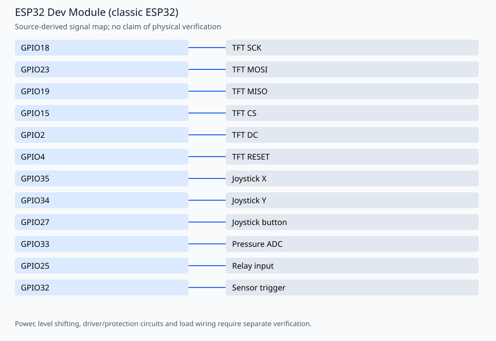

# ESP32 TFT control panel

An ILI9341 control panel with joystick navigation, analog pressure monitoring/calibration, relay modes and local Wi-Fi settings. Developed by **Amir Mobasheraghdam**. The files are alternative prototype versions, not parts of one application.

## Reproducible build

Install Python 3 and **Arduino CLI 1.3.1**, then run from this repository:

```bash
python3 tools/check_firmware.py --install
```

The helper installs `esp32:esp32@2.0.17` and `Adafruit BusIO@1.17.0`, `Adafruit GFX Library@1.12.1`, `Adafruit ILI9341@1.6.2`. It compiles these alternatives
separately in temporary folders, without uploading or rewriting the originals:

- `glatter sensor.ino`
- `sketch_oct28a.ino`
- `glatterc28a.ino`
- `complete presur.cpp`
- `Pressure Sensor Calibration Code.cpp`

Build target: `esp32:esp32:esp32`. Once dependencies are installed, omit `--install`
to build offline. `--jobs 2` is the default. Set `ARDUINO_CLI` to a CLI executable
or wrapper when using a custom Arduino configuration. Exact build inputs are in
[`tools/firmware.json`](tools/firmware.json). Library dependencies are listed
explicitly and installed with `--no-deps` so transitive updates cannot silently
replace the pinned versions. These are tested build versions, not a claim that
all other core/library versions are incompatible.

The GitHub Actions workflow repeats the firmware checks on pushes and pull
requests. Compilation validates software/toolchain compatibility; it does not
establish hardware safety or successful physical operation.

## Signal assignments



| Signal | Board pin |
| --- | --- |
| TFT SCK | GPIO18 |
| TFT MOSI | GPIO23 |
| TFT MISO | GPIO19 |
| TFT CS | GPIO15 |
| TFT DC | GPIO2 |
| TFT RESET | GPIO4 |
| Joystick X | GPIO35 |
| Joystick Y | GPIO34 |
| Joystick button | GPIO27 |
| Pressure ADC | GPIO33 |
| Relay input | GPIO25 |
| Sensor trigger | GPIO32 |

## Operation and validation limits

The map is checked against **`glatterc28a.ino`**. The relay is active LOW. Verify the exact selected variant and wiring before flashing; no pressure accuracy, protection function or actuator behavior has been physically validated here. GPIO33 is an ADC input and must not receive an arbitrary industrial sensor voltage.

The build helper checks all three `.ino` variants and both `.cpp` variants separately; it keeps `.cpp` files as C++ rather than silently relying on Arduino-generated prototypes. `Amirmobasher-n8n` is not firmware. The full variants start a local AP named **Kabelglaetter**; review the embedded example password and HTTP control endpoints before deployment.

See [HARDWARE.md](HARDWARE.md), [SECURITY.md](SECURITY.md) and [README.de.md](README.de.md) for the existing hardware and safety notes. Pin tables describe source assignments; relay loads, pressure interfaces and protection circuitry require hardware review.

No physical testing, new hardware photographs or measured electrical/optical
performance is claimed. Retain the author attribution and existing license/source
notices when reusing the project.

## License

**No standalone license file is committed.** Until the owner explicitly chooses and publishes a license, do not assume the source is under MIT, GPL or another open-source license. Existing source notices may impose additional restrictions.
